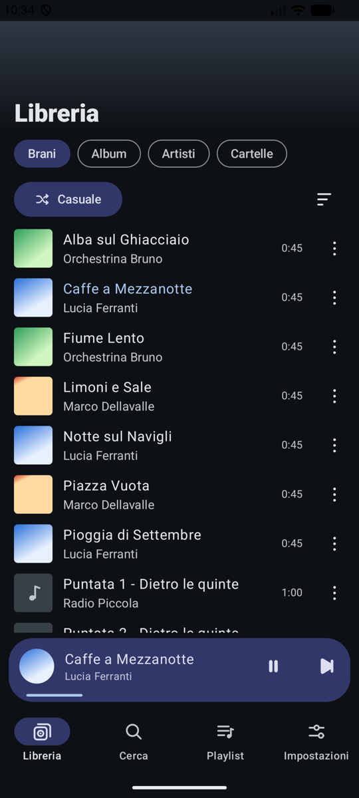
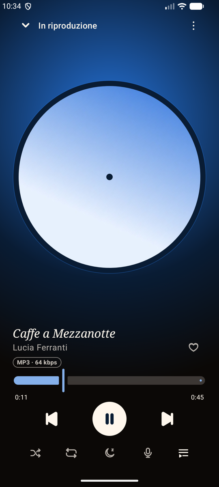
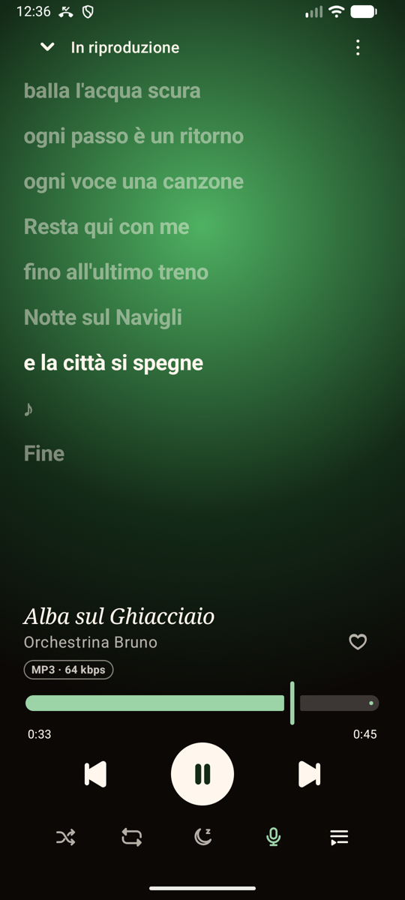
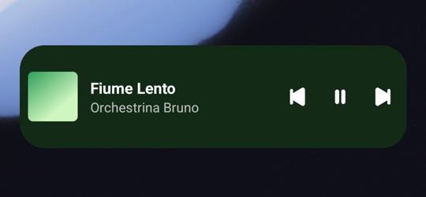

# P-layer

**Un lettore musicale per Android veloce, offline, che prende i colori dai tuoi album.**

[English](README.md) · [Scarica](#scarica) · [Privacy](#privacy)

---

P-layer riproduce la musica che hai già sul telefono. Non ha account, pubblicità o tracciamento. È scritto in Kotlin nativo con Jetpack Compose e Media3: legge la libreria una volta, la tiene in cache e usa la rete solo se attivi i testi online.

  
  
  
  

## Cosa fa

**Libreria**
- Brani, album, artisti e cartelle, con ricerca istantanea.
- Scegli le cartelle che contengono la tua musica.
- Nascondi un brano o spostalo nel cestino.
- Preferiti e playlist, che puoi importare ed esportare.

**Player**
- Colori presi dalla copertina e un disco in vinile che gira.
- Shuffle e ripetizione uguali da app, cuffie, schermata di blocco e widget.
- Ripresa della coda da dove eri rimasto.
- Timer di spegnimento.

**Testi sincronizzati**
- Da file `.lrc`, dai testi dentro MP3 e FLAC, e da LRCLIB solo se lo attivi.
- Tocca una riga per saltare a quel punto.

**Widget 4×1**
- Copertina e comandi, nel colore dell'album.
- ▶ funziona anche ad app chiusa.

**Lingue**
- Italiano e inglese. Da Android 13 puoi scegliere la lingua di P-layer separatamente da quella del telefono: Impostazioni → App → P-layer → Lingua.

## Scarica

Scarica l'APK dall'[ultima release](https://github.com/olex-labs/p-layer/releases/latest). Funziona da Android 8.0 in su.

## Privacy

Non ci sono analisi d'uso, account o report automatici: tutto resta sul telefono. L'unica richiesta di rete parte solo se attivi **Impostazioni → Cerca testi online** e un brano non ha testi locali. In quel caso a LRCLIB vengono inviati solo titolo, artista, album e durata del brano.

## Licenza

[GPL-3.0](LICENSE). Puoi usare, studiare, condividere e modificare P-layer. Se distribuisci una versione modificata, deve restare sotto GPL.
