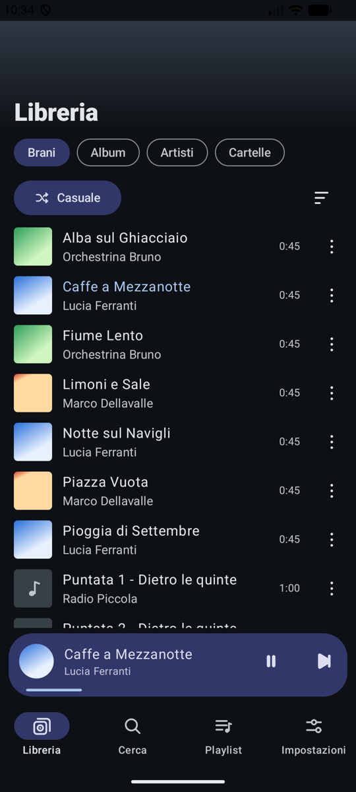
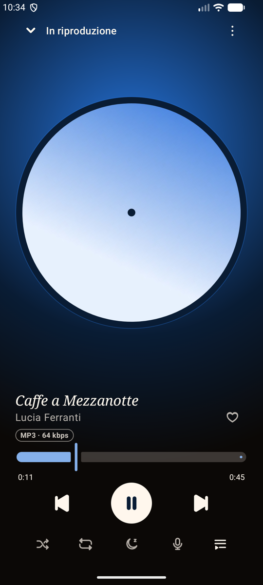
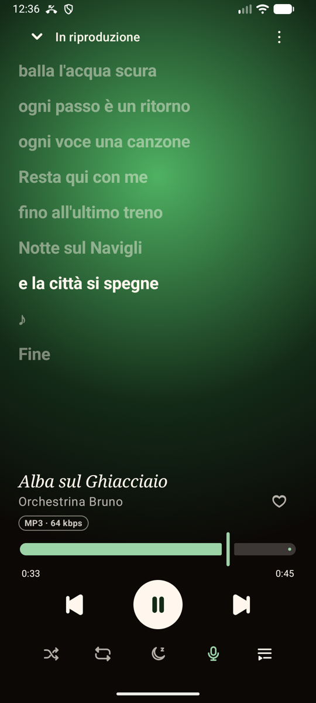
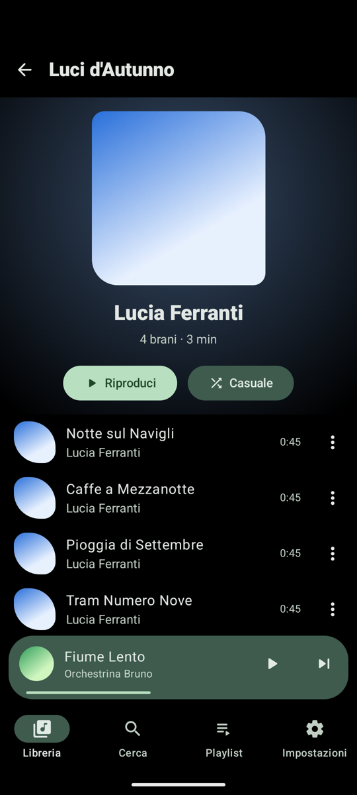
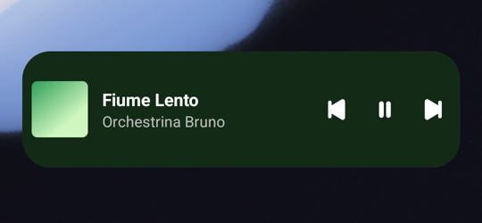

<div align="center">


# P-layer

**A fast, offline music player for Android that takes its colours from your albums.**

[](https://github.com/olex-labs/p-layer/actions/workflows/ci.yml)
[](https://github.com/olex-labs/p-layer/releases/latest)
[](LICENSE)


[Download](#download) · [Features](#features) · [Build](#build-from-source) · [Privacy](#privacy) · [Contributing](CONTRIBUTING.md) · [Italiano](README.it.md)

</div>

---

P-layer plays the music already on your phone. It has no account, no ads and no tracking. It is native Kotlin with Jetpack Compose and Media3, and it keeps the work it does small: it reads your library once, caches it, and only touches the network if you turn on online lyrics.

<p align="center">
  
  
  
  
</p>
<p align="center">
  
</p>

## Features

**Library**
- Songs, albums, artists and folders, with instant search.
- Choose which folders count as music. Everything else (voice notes, ringtones) stays out.
- Hide a song from the app, or move it to the system trash.
- Favourites and playlists. Playlists can be imported and exported as M3U.
- File quality label, for example `FLAC · 1411 kbps`.

**Player**
- The whole player is tinted by the album cover: the background glow, the controls and the status bar.
- A spinning vinyl disc that you can switch off. A landscape layout too.
- Shuffle and repeat work the same from the app, headphones, the lock screen and the widget.
- Your queue and position are saved and restored, so the app picks up where you left off.
- Sleep timer, after a set time or at the end of the current song.

**Synced lyrics**
- Reads `.lrc` files next to your songs, and lyrics embedded in MP3 (ID3 USLT/SYLT) and FLAC files.
- Optional online search through [LRCLIB](https://lrclib.net). It is off by default.
- Tap a line to jump to it.

**Home screen widget**
- A 4×1 bar with the cover, title and previous / play-pause / next buttons, in the album's colour.
- ▶ works even when the app is closed: it resumes your last queue where you left off.

**Languages**
- English and Italian. On Android 13+ you can pick P-layer's language separately from the phone's: Settings → Apps → P-layer → Language.

## Download

Get the APK from the [latest release](https://github.com/olex-labs/p-layer/releases/latest) and open it on your phone. You may need to allow installing apps from your browser or file manager.

| Requirement | |
|---|---|
| Android | 8.0 (API 26) or newer |
| Permissions | Music and audio files. Notifications, for the playback controls. Internet, used only by optional online lyrics. |
| Size | About 3 MB |

## Build from source

You need JDK 17 or newer and the Android SDK. A recent Android Studio is the easiest way to get both.

```bash
git clone https://github.com/olex-labs/p-layer.git
cd p-layer
./gradlew assembleDebug          # app/build/outputs/apk/debug/
./gradlew testDebugUnitTest      # unit tests (JVM + Robolectric)
./gradlew lintDebug
```

Release builds are signed only if a `keystore.properties` file exists. Otherwise they use the debug key. [docs/RELEASE.md](docs/RELEASE.md) explains how to create a key and publish a release.

## How it works

| Layer | What it does |
|---|---|
| `data/library` | Reads MediaStore, filters by your music folders and hidden songs, and keeps a snapshot on disk for instant start-up. |
| `playback` | A `MediaSessionService` built on ExoPlayer. `ShufflingPlayer` reorders the queue itself, so every controller sees the same shuffle. |
| `lyrics` | Tries a sidecar `.lrc` file first, then lyrics embedded in the file, then the cache, then LRCLIB (if you allowed it). |
| `widget` | `RemoteViews`, with no extra library. The service updates it only when the song or the play state changes. |
| `ui` | Jetpack Compose and Material 3. The colours are generated from the album cover with Palette. |

Built with Kotlin, Jetpack Compose, Media3 (ExoPlayer and MediaSession), Hilt, Room, DataStore, Coil and kotlinx.serialization.

The design notes for each version are in [`docs/superpowers`](docs/superpowers) (Italian).

## Privacy

P-layer has no analytics, no crash reporting and no account. Your library, playlists and settings stay on your device.

The app makes a network request in one case only: you have turned on **Settings → Search lyrics online** and a song has no local lyrics. The request goes to [LRCLIB](https://lrclib.net) and contains only the song's title, artist, album and duration.

## Roadmap

- [ ] Android Auto
- [ ] Equalizer and ReplayGain
- [ ] Crossfade
- [ ] Larger widget sizes

Ideas and bug reports are welcome in [Issues](https://github.com/olex-labs/p-layer/issues).

## Contributing

Read [CONTRIBUTING.md](CONTRIBUTING.md). By taking part you agree to follow the [Code of Conduct](CODE_OF_CONDUCT.md). To report a security problem, see [SECURITY.md](SECURITY.md).

## License

P-layer is free software, released under the [GNU General Public License v3.0](LICENSE). You can use, study, share and change it. If you distribute a modified version, it must stay under the GPL too.

Lyrics are provided by [LRCLIB](https://lrclib.net). The icons were drawn for this project.
